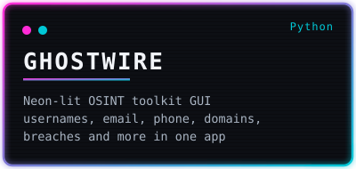
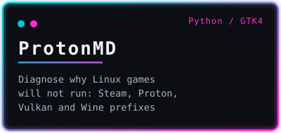
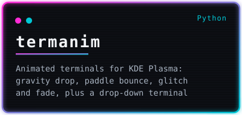

 

  

### 🚀 Projects

## 🎮 Why does my game work on Windows and crash on Linux?

Linux gaming is better than it has ever been, and it still breaks in ways that are hard to see.
A game built for Windows runs through a stack of translation layers: **Proton** wraps **Wine**,
**DXVK** turns DirectX calls into **Vulkan**, and your GPU driver sits underneath all of it.
When the game fails, the error is rarely where the problem is.

The usual suspects:

- 🧱 **A missing 32-bit library.** The game is 32-bit, the driver package isn't, and nothing says so.
- 🍷 **A half-created Wine prefix.** One interrupted first launch leaves a broken folder that quietly fails forever.
- 🔢 **Kernel limits set for 2010.** `vm.max_map_count` is too low and big games crash with no explanation.
- 🧪 **Launch options nobody remembers.** A fix from a forum post two years ago is now the thing breaking the game.
- 🧩 **A missing runtime.** The game needs vcredist or .NET, and the prefix has neither.
- 🛡️ **Anti-cheat.** Sometimes the answer really is "this one won't run", and knowing that saves hours.

Each fix is easy once you know it. Finding it is the hard part, so I'm building a tool that finds it for you.

## 🔧 ProtonMD

  
  

**[ProtonMD](https://github.com/metalmike17/protonmd)** is a doctor for your Linux games. Point it at your
Steam library and it checks your GPU drivers, Vulkan, kernel limits, Wine prefixes, Proton versions,
launch options and shader caches. It tells you what's wrong in plain language, and offers fixes that
show you the exact command and ask first.

  

- ✅ Finds Steam libraries on **external drives**, even ones Steam doesn't list
- ✅ Backs up a prefix before resetting it, and never deletes without asking
- ✅ Native **GTK4 + libadwaita** app, available as a **Flatpak** and an **AUR** package
- ✅ Checks are plain Python and plain-data rules, so new known-fixes are easy to contribute

**Got a game that won't run, or a fix you wish a tool would catch?**
[Open an issue](https://github.com/metalmike17/protonmd/issues/new/choose). New checks are the best way to help.

## 👻 GHOSTWIRE

  
  

**[GHOSTWIRE](https://github.com/metalmike17/Ghostwire-OSINT)** is every OSINT tool you actually use, in one neon-lit
desktop cockpit. Pick a module, fill in a target, hit **Start**, and watch the results stream in. No flags to
remember and no copy-pasting between terminals.

  

- 🔎 **12 modules**: username, email, phone, Instagram, domain, IP, Wayback, metadata, GitHub, network, breach and crawl
- 📦 Downloads for **Linux** (AppImage, deb, rpm, Flatpak), plus experimental **Windows** and **macOS** builds
- 🔓 Free and open source under MIT, using public sources only

**[⬇️ Download GHOSTWIRE](https://github.com/metalmike17/Ghostwire-OSINT/releases/latest)**

## 🎬 termanim

  
  

**[termanim](https://github.com/metalmike17/termanim)** gives your terminal an entrance. On KDE Plasma (Wayland),
terminal windows fall, bounce, slingshot, glitch or fade into place instead of just appearing, and one hotkey
summons a drop-down terminal with the same animations.

  

- 🎞️ **11 animations**: gravity, paddle, slingshot, glitch, fade, slide, shake, pendulum, orbit, yoyo and random
- ⌨️ **F12** drop-down terminal, with a GTK4 + libadwaita settings window
- 📦 Available as a release tarball and an **AUR** package (`PKGBUILD` included)

**[⬇️ Get termanim](https://github.com/metalmike17/termanim/releases/latest)**

## 🧰 Tools

**Setup:** CachyOS · Hyprland · Ghostty

<i>If ProtonMD saves you an evening of debugging, a ⭐ on the repo is the best thank-you.</i>

